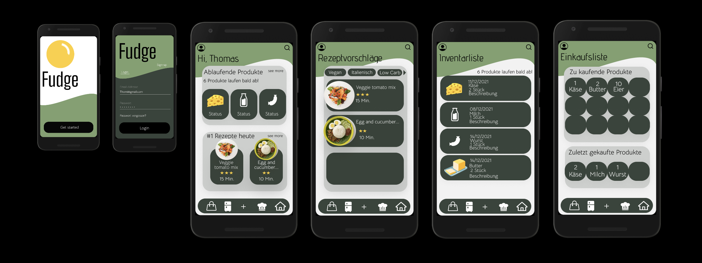
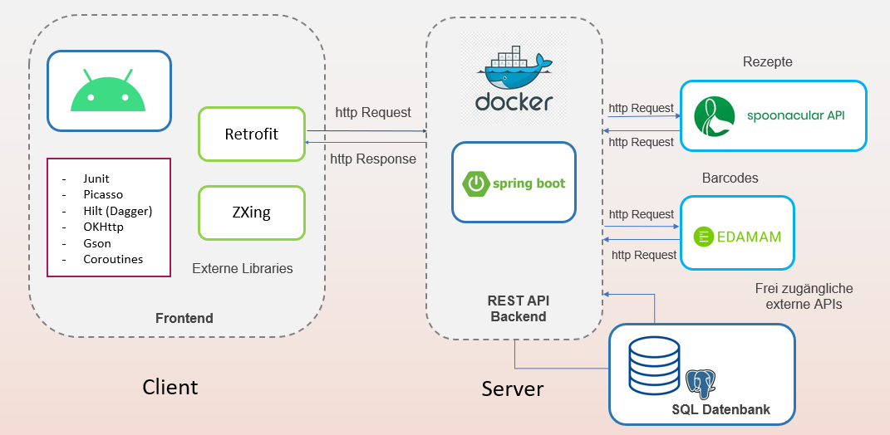

<div id="top"></div>

<div align="center">
  

  <h1>Fudge</h1>

  <p>
    <strong>Track the food that you have. Cook it before it is bad.</strong>
  </p>

  <p>
    An Android application with a Spring Boot REST API. Fudge keeps the
    inventory of your kitchen, reads a product from its barcode and suggests
    recipes for the products that expire soon.
  </p>

  <p>
    <a href="#architecture">Architecture</a> ·
    <a href="#quick-start">Quick start</a> ·
    <a href="#development">Development</a> ·
    <a href="#tests-and-quality">Tests</a> ·
    <a href="#design-system">Design</a>
  </p>
</div>

<p align="center">
  
  
  
  
  
</p>

---

## Table of contents

1. [What the application does](#what-the-application-does)
2. [Design prototype](#design-prototype)
3. [Architecture](#architecture)
4. [Quick start](#quick-start)
5. [Development](#development)
6. [Tests and quality](#tests-and-quality)
7. [Design system](#design-system)
8. [REST API](#rest-api)
9. [Configuration](#configuration)
10. [Demo video](#demo-video)
11. [Repository](#repository)
12. [Contributing](#contributing)
13. [License](#license)

---

## What the application does

Each year a household throws away food that is still good, because nobody
knows what is in the refrigerator. Fudge solves this problem in three steps:

| Step | What the user does | What the application does |
|---|---|---|
| **1. Collect** | Scans the barcode of a product | Reads the name and the nutrition value from the Edamam food database |
| **2. Watch** | Opens the inventory list | Shows each product with the colour of its state: green is fresh, yellow is this week, red is bad |
| **3. Cook** | Opens the recipe suggestions | Asks the Spoonacular API for recipes that use the products that expire soon |

Other functions: two shopping lists (one for the next purchase, one as a
template of the last purchase), a profile with food preferences such as
"Vegan", and a notification before a product expires.

<p align="right">(<a href="#top">back to top</a>)</p>

---

## Design prototype

<div align="center">
  
</div>

<div align="center">

[**Open the interactive Figma prototype**](https://www.figma.com/proto/J7pup60VT1Uw12lk1U4hGL/FeedMe-App?node-id=1-4&starting-point-node-id=1%3A4)

</div>

> The prototype shows the user flow and the structure of the screens. The
> colours of the application come from this design. See
> [Design system](#design-system).

<p align="right">(<a href="#top">back to top</a>)</p>

---

## Architecture

The two parts of the project have the same idea: the layer of the user
interface knows nothing about the database, and the layer of the data knows
nothing about the screens. A change in one layer therefore stops at the border
of that layer.

```
┌──────────────────────────────── Android client ───────────────────────────────┐
│                                                                               │
│   Fragment  ──reads──▶  ViewModel  ──calls──▶  Repository  ──calls──▶ Retrofit│
│   (view)        LiveData  (state)                (data)                       │
│      ▲                                              │                         │
│      └──────────────── Hilt gives each part ────────┘                         │
└───────────────────────────────────────┬───────────────────────────────────────┘
                                        │ HTTPS, JSON
┌───────────────────────────────────────▼───────────────────────────────────────┐
│                            Spring Boot REST API                               │
│                                                                               │
│   Resource  ──calls──▶  Service  ──calls──▶  Repository  ──SQL──▶ PostgreSQL  │
│   (REST)                (rules)              (JdbcTemplate)                   │
│        │                                                                      │
│        └──▶ RequestMapper (JSON to model)      JsonHttpClient ──▶ Edamam,     │
│                                                                   Spoonacular │
└───────────────────────────────────────────────────────────────────────────────┘
```

<div align="center">
  
</div>

### The parts of the backend

| Package | Task |
|---|---|
| `resources` | REST endpoints. They read the body of the request and give an answer. |
| `services` | Rules of the application, for example "count the expiring products only when the user gave permission". |
| `repositories` | SQL statements. Each repository works on one part of the database. |
| `models` | The objects of the application. Lombok writes the access methods. |
| `common/mapper` | `RequestMapper` turns the JSON body into a model. All three controllers use it. |
| `common/rest` | `JsonHttpClient` sends the requests to the external APIs. A test gives a stub answer. |
| `common/utils` | `Attempt` turns an error into a log entry and a default value. `DateUtils`, `ImageUtils`, `WordUtils`. |
| `common/config` | `ApiProperties` reads the credentials from the environment. |

### Built with

**Android client**
Kotlin · MVVM with ViewModel and LiveData · Jetpack Navigation · Hilt ·
Retrofit and OkHttp · Coroutines · Glide and Picasso · ZXing for the barcode ·
WorkManager · ViewBinding · Material Components

**REST API**
Java 11 · Spring Boot 2.6 · Spring JDBC · PostgreSQL 13 · JWT (jjwt) ·
BCrypt · Lombok · Docker

**Quality**
JUnit 5 · Mockito · AssertJ · JaCoCo · Checkstyle · SpotBugs (backend) ·
JUnit 4 · Truth · Robolectric · Espresso · ktlint · detekt (frontend)

<p align="right">(<a href="#top">back to top</a>)</p>

---

## Quick start

### What you need

| Program | Version | For |
|---|---|---|
| Java | 17 (the code uses the level of Java 11) | REST API |
| Docker | 20 or later | PostgreSQL database |
| Android Studio | Bumblebee or later | Android client |
| Android SDK | API 27 or later | Android client |
| GNU Make | 3.81 or later | the commands below |

### Three commands

```bash
git clone https://github.com/JaninaMattes/Fudge-Cooking-App.git
cd Fudge-Cooking-App

make db-up          # 1. starts PostgreSQL in Docker
make backend-run    # 2. starts the REST API on port 80
make frontend-build # 3. builds the APK of the Android client
```

`make help` shows all commands.

<p align="right">(<a href="#top">back to top</a>)</p>

---

## Development

All work goes through the `Makefile`, so a command is the same on your machine
and in the pipeline.

| Command | What it does |
|---|---|
| `make help` | Shows all commands |
| `make build` | Builds both parts |
| `make test` | Runs the tests of both parts |
| `make lint` | Runs the style check of both parts |
| `make coverage` | Writes the coverage reports |
| `make verify` | Runs every check that the pipeline runs |
| `make clean` | Removes the files of the last build |

Each command also works for one part only: `make backend-test`,
`make frontend-lint`, and so on.

### The pipeline

Two workflows of GitHub Actions run on each push and on each pull request:

| Workflow | Steps |
|---|---|
| [`backend.yml`](.github/workflows/backend.yml) | Checkstyle → tests → coverage gate → SpotBugs → JAR file |
| [`frontend.yml`](.github/workflows/frontend.yml) | ktlint → detekt → Android Lint → unit tests → coverage → APK; the main branch also runs the tests of the user interface on an emulator and keeps the video |

The pipeline stops the build when the coverage falls under 95 % of the
instructions or under 90 % of the branches.

<p align="right">(<a href="#top">back to top</a>)</p>

---

## Tests and quality

### Backend

```
534 tests · 100 % of the instructions · 100 % of the branches · 0 findings of SpotBugs
```

```bash
make backend-verify     # style, tests, coverage gate and static analysis
make backend-coverage   # writes target/site/jacoco/index.html
```

The tests need **no database and no network**:

- A **test double** (`RecordingJdbcTemplate`) answers the SQL statements of
  the repositories and records what each repository sent. The tests therefore
  prove the order of the values of each statement.
- A **stub** of `JsonHttpClient` answers the external APIs with a JSON text of
  the test.
- A **small HTTP server** of the Java library tests the real HTTP client.
- **MockMvc** sends a request to each REST endpoint and reads the answer.

### Frontend

```bash
make frontend-test      # unit tests on the development machine
make frontend-lint      # ktlint, detekt and the Android Lint
make frontend-ui-test   # tests on an emulator or on a telephone
```

The unit tests of the client need no emulator, because the functions of
`ui/common/utils` now use `java.text` and not `android.icu`.

<p align="right">(<a href="#top">back to top</a>)</p>

---

## Design system

The colours of the application come from the Figma prototype: a sage green
header, dark green cards, a cream background and a yellow accent.

| Token | Colour | Where |
|---|---|---|
| `brand_primary` |  `#92A880` | Header, status bar |
| `brand_secondary` |  `#2F3B2C` | Buttons, navigation bar, dark cards |
| `brand_accent` |  `#F2C230` | Logo, stars of a rating, active navigation |
| `surface_background` |  `#F4F2EA` | Background of a screen |
| `text_primary` |  `#1F2419` | Text |

### The colour of a state

The user reads the state of the food from the colour, and does not have to
compare the dates:

| State | Colour | When |
|---|---|---|
| **Fresh** |  green | More than 7 days |
| **This week** |  yellow | 4 to 7 days |
| **Use soon** |  orange | 1 to 3 days, or today |
| **Expired** |  red | The date is in the past |

The rule is in
[`ExpiryStatus`](frontend/android-feedme-app/app/src/main/java/com/mobilesystems/feedme/ui/common/utils/ExpiryStatus.kt),
and a unit test proves each border of the rule.

### The files of the design system

| File | Holds |
|---|---|
| `res/values/colors.xml` | The brand palette and the semantic tokens |
| `res/values-night/colors.xml` | The same tokens for the dark mode |
| `res/values/dimens.xml` | Distances with a step of 4dp, the type scale, the corner radii |
| `res/values/styles.xml` | The styles of the text, of the buttons and of the cards |
| `res/values/themes.xml` | The themes of the application |

A layout uses a **token** (`@color/text_primary`) and not a raw colour. A
change of the brand therefore needs one change in `colors.xml` and no change
in the 51 layout files.

<p align="right">(<a href="#top">back to top</a>)</p>

---

## REST API

Base address: `http://<host>:80/api`

| Method | Path | What it does |
|---|---|---|
| `POST` | `/users/login` | Logs a user in and gives a JWT token |
| `POST` | `/users/register` | Makes a user with the empty lists |
| `POST` | `/users/email` | Tells if an email address is free |
| `GET` | `/users/{userId}` | Reads the profile of a user |
| `PUT` | `/users/update/...` | Changes the profile, the image or a permission |
| `GET` | `/products/all/{userId}` | Reads the inventory list |
| `POST` | `/products/add` | Puts a product on the inventory list |
| `PUT` | `/products/update` | Changes a product |
| `DELETE` | `/products/delete` | Takes a product off the list |
| `GET` | `/products/count/expiring/{userId}` | Counts the products that expire soon |
| `GET` | `/shoppinglist/current/{userId}` | Reads the current shopping list |
| `GET` | `/shoppinglist/old/{userId}` | Reads the old shopping list |
| `POST` | `/shoppinglist/current/create` | Makes a product on the current list |
| `GET` | `/recipe/all/{userId}` | Reads the recipes of a user |
| `GET` | `/recipe/rest/poll/{userId}` | Loads new recipes from Spoonacular |
| `GET` | `/barcode/rest/{barcode}` | Reads a product from its barcode |
| `GET` | `/dashboard/shortexp/{userId}` | Reads the products of the start screen |
| `GET` | `/db/init` | Corrects the sequences of the database |

`make backend-docs` writes the full Javadoc to
`backend/food-tracker-api/target/site/apidocs/index.html`.

<p align="right">(<a href="#top">back to top</a>)</p>

---

## Configuration

The application reads each value from
an environment variable and uses a default value only for the local machine. 

```bash
export FT_DB_URL=jdbc:postgresql://localhost:5432/foodtrackerdb
export FT_DB_USER=foodtracker
export FT_DB_PASSWORD=<your password>

export FT_API_SECRET_KEY=<a long text for the JWT tokens>
export FT_SPOONACULAR_KEY=<your key>
export FT_EDAMAM_APP_ID=<your application ID>
export FT_EDAMAM_BARCODE_KEY=<your key>
```

See
[`application.properties`](backend/food-tracker-api/src/main/resources/application.properties)
and
[`ApiProperties`](backend/food-tracker-api/src/main/java/com/foodtracker/foodtrackerapi/common/config/ApiProperties.java).

The Android client reads the address of the API from
`common/config/Constants.kt`.

<p align="right">(<a href="#top">back to top</a>)</p>

---

## Demo video

The project records a walk through the application on an **emulator**. No
telephone is necessary:

```bash
make demo-video              # with Maestro: the video shows the name of each step
MODE=adb make demo-video     # with the Android tools only
```

The pipeline also records a video on each build of the main branch and keeps
it as an artifact of the run.

[**docs/DEMO_VIDEO.md**](docs/DEMO_VIDEO.md) compares the free tools of the
market (Maestro, adb screenrecord, scrcpy, Espresso, Appium, Fastlane) and
says which one fits which need.

<p align="right">(<a href="#top">back to top</a>)</p>

---

## Repository

```
Fudge-Cooking-App/
├── Makefile                      Commands for the build, the tests and the quality
├── .github/workflows/            Pipelines of GitHub Actions
├── assets/                       Logo, screens of the design, architecture
├── docs/
│   └── DEMO_VIDEO.md             The tools for a demo video
├── tools/demo/                   Script and flows for the demo video
├── backend/food-tracker-api/
│   ├── config/checkstyle/        Style rules
│   ├── config/spotbugs/          Findings that the project accepts
│   ├── db/                       Schema and test data of PostgreSQL
│   ├── docker-compose.yml        API and database in Docker
│   └── src/
│       ├── main/java/            The code of the REST API
│       └── test/java/            534 tests
└── frontend/android-feedme-app/
    ├── config/detekt/            Rules of the static analysis
    └── app/src/
        ├── main/java/            The code of the Android client
        ├── main/res/             Layouts and the design system
        ├── test/                 Tests for the development machine
        └── androidTest/          Tests for an emulator
```

<p align="right">(<a href="#top">back to top</a>)</p>

---

## Contributing

1. Make a branch: `git checkout -b feature/my-feature`
2. Write the code **and the tests**
3. Run `make verify`. The pipeline runs the same checks.
4. Make a commit and a pull request

<p align="right">(<a href="#top">back to top</a>)</p>

---

## License

MIT. See [LICENSE](LICENSE).

Fudge is the base of the larger project
[Cookly](https://github.com/JaninaMattes/Smart-Pantry-Planner/).

<p align="right">(<a href="#top">back to top</a>)</p>
